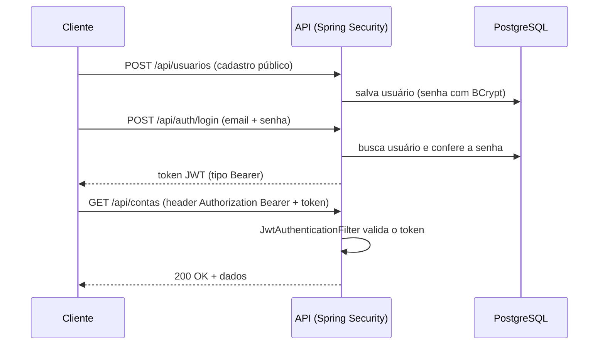
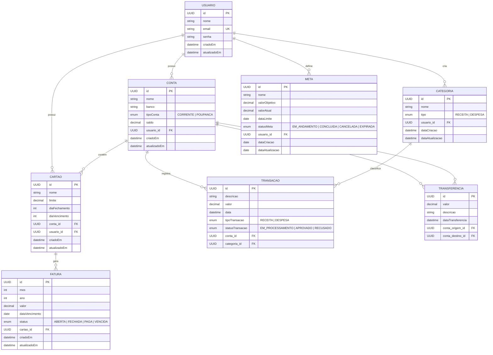
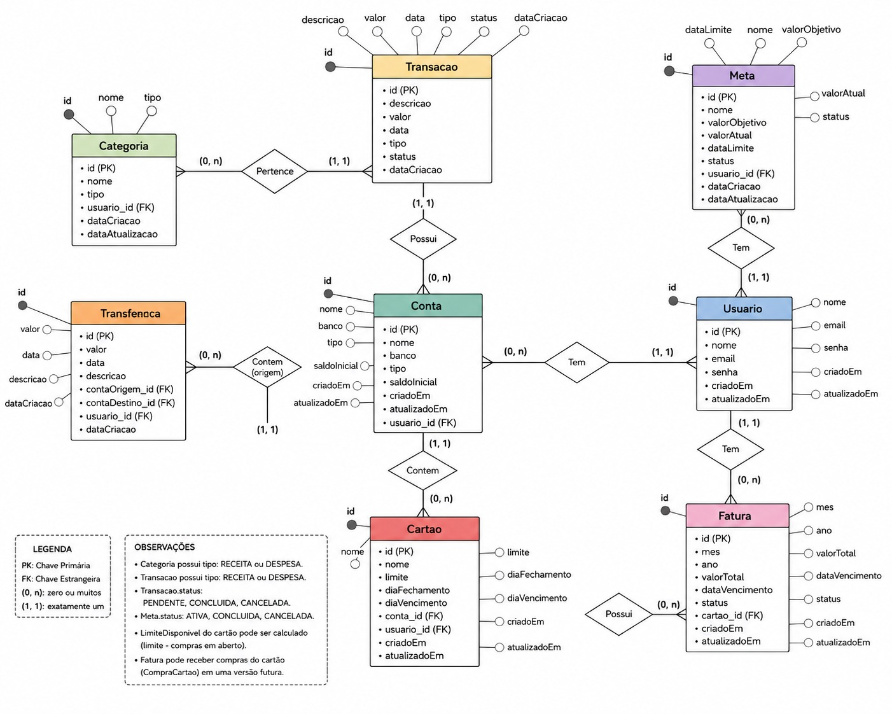
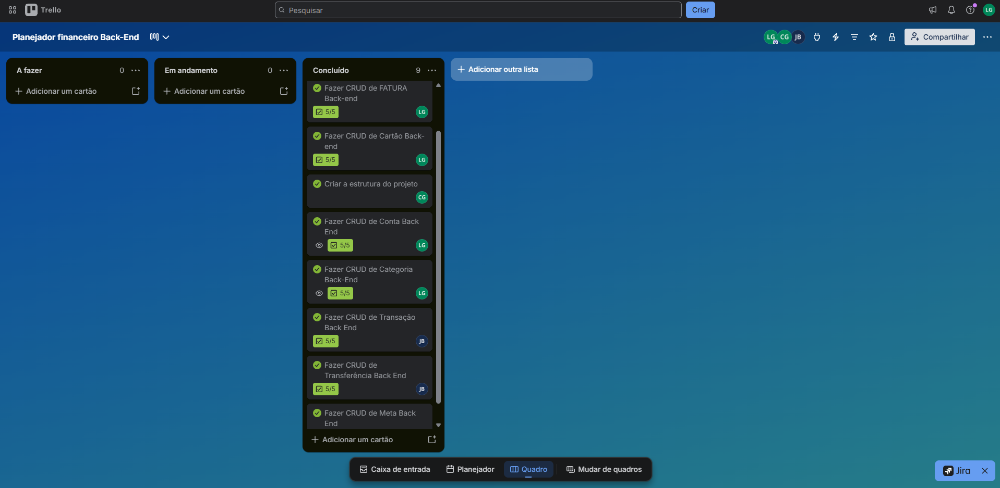

# 💰 Planejador Financeiro — Backend

Backend de um sistema de planejamento financeiro pessoal, desenvolvido em **Java** com **Spring Boot**. A API permite que um usuário se cadastre e se autentique, gerencie suas contas bancárias e cartões de crédito, categorize receitas e despesas, registre transações e transferências, acompanhe faturas e defina metas financeiras.

> ✅ **Status:** projeto concluído (versão 1.0 do backend), desenvolvido como estudo em grupo. As melhorias planejadas para versões futuras estão listadas em [Melhorias futuras](#-melhorias-futuras).

---

## 👥 Equipe

Projeto desenvolvido em grupo por:

- **Lucas Bonan**
- **Carlos Eduardo**
- **João Gabriel Barros**

---

## 📌 Sobre o projeto

O **Planejador Financeiro** nasceu como um projeto de estudo em grupo, com o objetivo de aplicar na prática conceitos de desenvolvimento backend com Spring Boot: modelagem de domínio, arquitetura em camadas, persistência com JPA/Hibernate, validação de dados, autenticação com JWT, tratamento centralizado de exceções, documentação de API e containerização.

A proposta do sistema é permitir que um usuário:

- Crie sua conta e faça **login**, recebendo um token JWT para acessar a API;
- Cadastre suas **contas bancárias** (corrente, poupança) e acompanhe o saldo de cada uma;
- Organize receitas e despesas por **categorias** personalizadas;
- Registre **transações** (receitas e despesas) vinculadas a uma conta e categoria;
- Realize **transferências** entre contas, com validação de saldo;
- Cadastre **cartões de crédito** vinculados a uma conta e acompanhe suas **faturas** mensais;
- Defina **metas financeiras** com valor objetivo e prazo, registrando aportes e acompanhando o progresso.

Todos os dados pertencem a um usuário: contas, categorias, cartões e metas guardam o `usuario_id`; transações, transferências e faturas se ligam ao usuário por meio da conta ou do cartão.

---

## 🛠️ Tecnologias utilizadas

| Tecnologia | Finalidade |
|---|---|
| **Java 17** | Linguagem principal do projeto |
| **Spring Boot 4.1.1** | Framework base da aplicação |
| **Spring Web (MVC)** | Construção da API REST |
| **Spring Data JPA** (Hibernate) | Persistência e mapeamento objeto-relacional |
| **Spring Security** | Autenticação e autorização (sessão *stateless*) |
| **JWT** (`jjwt` 0.12.6) | Geração e validação dos tokens de acesso |
| **BCrypt** | Criptografia (hash) das senhas dos usuários |
| **Bean Validation** (`spring-boot-starter-validation`) | Validação dos dados recebidos pela API |
| **PostgreSQL 16** | Banco de dados relacional |
| **springdoc-openapi 3.1.0 (Swagger UI)** | Documentação interativa da API |
| **Lombok** | Redução de código repetitivo (getters, setters, construtores) |
| **Docker** e **Docker Compose** | `Dockerfile` da aplicação e `compose.yml` com o PostgreSQL |
| **Variáveis de ambiente (`.env`)** | Configuração de banco e JWT fora do código |
| **Maven** (Maven Wrapper) | Gerenciador de dependências e build |
| **Spring Boot DevTools** | Produtividade em desenvolvimento (reload automático) |
| **Git / GitHub** | Versionamento, branches por funcionalidade e Pull Requests |
| **Trello** | Organização das tarefas do time |

---

## 🏗️ Arquitetura

O projeto segue uma **arquitetura em camadas**, separando claramente as responsabilidades:

```
Controller  →  Service  →  Repository  →  Banco de Dados
   (API)      (regras de     (acesso a
              negócio)         dados)
```

- **`api.controller`** — expõe os endpoints REST, recebe requisições HTTP e devolve respostas. Não contém regra de negócio, apenas orquestra a chamada ao `Service`.
- **`api.dto`** — objetos de transferência de dados (Request/Response) usados na entrada e saída da API. A API nunca expõe as entidades JPA diretamente, evitando acoplamento entre o contrato da API e o modelo do banco.
- **`service`** — contém as regras de negócio: validações de domínio, orquestração entre repositórios, conversão entre DTO e entidade.
- **`model.entity`** — as entidades JPA (e enums), que representam as tabelas do banco de dados.
- **`model.repository`** — interfaces `JpaRepository` responsáveis pelo acesso direto aos dados.
- **`security`** — configuração do Spring Security, filtro de autenticação JWT (`JwtAuthenticationFilter`), geração/validação de tokens (`JwtService`) e integração com os usuários do sistema (`UsuarioDetailsServiceImpl`).
- **`exceptions`** — exceções customizadas (`RecursoNaoEncontradoException`, `SaldoInsuficienteException`) e um `GlobalExceptionHandler` (`@RestControllerAdvice`) que centraliza o tratamento de erros de toda a API, garantindo respostas padronizadas (status HTTP correto + corpo de erro consistente) em qualquer endpoint do projeto.

---

## 🔐 Autenticação e segurança

A API usa **autenticação stateless com JWT**:



- **Rotas públicas:** `POST /api/auth/login`, `POST /api/usuarios` (cadastro) e a documentação Swagger (`/swagger-ui/**`, `/v3/api-docs/**`).
- **Demais rotas:** exigem o header `Authorization: Bearer <token>`.
- As **senhas** são armazenadas com hash BCrypt, nunca em texto puro.
- O token é assinado com o segredo definido em `JWT_SECRET` e expira conforme `JWT_EXPIRATION` (padrão: 24 horas).
- Login com credenciais inválidas retorna `401` com mensagem padronizada.
- Os endpoints aceitam requisições do front-end local (`http://localhost:5173`) via `@CrossOrigin`.

---

## 🗂️ Estrutura do projeto

```
financeiro/
├── src/
│   └── main/
│       ├── java/
│       │   └── planejador/financeiro/
│       │       ├── PlanejadorFinanceiroApplication.java
│       │       ├── api/
│       │       │   ├── controller/       # Endpoints REST
│       │       │   │   ├── AuthController.java
│       │       │   │   ├── UsuarioController.java
│       │       │   │   ├── ContaController.java
│       │       │   │   ├── CategoriaController.java
│       │       │   │   ├── TransacaoController.java
│       │       │   │   ├── TransferenciaController.java
│       │       │   │   ├── CartaoController.java
│       │       │   │   ├── FaturaController.java
│       │       │   │   └── MetaController.java
│       │       │   └── dto/              # Objetos de entrada/saída da API (Request/Response)
│       │       │
│       │       ├── model/
│       │       │   ├── entity/           # Entidades JPA (tabelas do banco)
│       │       │   │   ├── Usuario.java
│       │       │   │   ├── Conta.java
│       │       │   │   ├── Categoria.java
│       │       │   │   ├── Transacao.java
│       │       │   │   ├── Transferencia.java
│       │       │   │   ├── Cartao.java
│       │       │   │   ├── Fatura.java
│       │       │   │   ├── Meta.java
│       │       │   │   └── (enums: TipoConta, TipoCategoria, TipoTransacao,
│       │       │   │        StatusTransacao, StatusFatura, StatusMeta)
│       │       │   │
│       │       │   └── repository/       # Interfaces de acesso a dados
│       │       │
│       │       ├── service/              # Regras de negócio
│       │       │
│       │       ├── security/             # Spring Security + JWT
│       │       │   ├── SecurityConfig.java
│       │       │   ├── JwtAuthenticationFilter.java
│       │       │   ├── JwtService.java
│       │       │   ├── UsuarioDetailsImpl.java
│       │       │   └── UsuarioDetailsServiceImpl.java
│       │       │
│       │       └── exceptions/           # Tratamento centralizado de erros
│       │           ├── GlobalExceptionHandler.java
│       │           ├── RecursoNaoEncontradoException.java
│       │           └── SaldoInsuficienteException.java
│       │
│       └── resources/
│           └── application.properties
│
├── Dockerfile                            # Imagem da aplicação (Temurin 17)
├── compose.yml                           # PostgreSQL 16 para desenvolvimento
├── .env.example                          # Modelo das variáveis de ambiente
├── pom.xml
└── mvnw / mvnw.cmd
```

---

## 🧩 Modelo de domínio

| Entidade | Descrição |
|---|---|
| **Usuario** | Dono de todos os dados financeiros. Possui e-mail único e senha criptografada. |
| **Conta** | Conta bancária do usuário (corrente ou poupança), com banco, saldo e vínculo a um `Usuario`. |
| **Categoria** | Classificação de receita ou despesa (ex: Alimentação, Salário), vinculada a um `Usuario`. |
| **Transacao** | Registro de uma receita ou despesa, com status, vinculada a uma `Conta` e a uma `Categoria`. |
| **Transferencia** | Movimentação de valores entre duas contas (origem e destino). Valida saldo suficiente e atualiza o saldo das duas contas. |
| **Cartao** | Cartão de crédito vinculado a uma `Conta` e a um `Usuario`, com limite, dia de fechamento e dia de vencimento. |
| **Fatura** | Fatura mensal (mês/ano) de um `Cartao`, com valor, data de vencimento e status (`ABERTA`, `FECHADA`, `PAGA`, `VENCIDA`). |
| **Meta** | Objetivo financeiro do usuário, com valor alvo, valor atual, prazo (`dataLimite`) e status (`EM_ANDAMENTO`, `CONCLUIDA`, `CANCELADA`, `EXPIRADA`). |

### Regras de negócio implementadas

- **Transferência:** a conta de origem e a de destino não podem ser a mesma; se o saldo da origem for menor que o valor, a API responde `400` com `SaldoInsuficienteException`.
- **Meta:** o aporte (`PATCH /api/metas/{id}/aporte`) deve ser positivo e só é aceito em metas `EM_ANDAMENTO`; ao atingir o valor objetivo, a meta passa automaticamente para `CONCLUIDA`.
- **Fatura:** nasce com status `ABERTA` e valor `0` quando não informados.
- **Usuário:** nome, e-mail válido e senha com no mínimo 6 caracteres são obrigatórios.

---

## 🗺️ Modelagem do banco de dados

Diagrama Entidade-Relacionamento (DER) do projeto. Os relacionamentos seguem a notação de cardinalidade do Mermaid (`||` = exatamente um, `o{` = zero ou muitos).



<details>
<summary>🖼️ Ver o DER em imagem (modelagem relacional original)</summary>

<br>



</details>

---

## 📡 Endpoints da API

A API segue o padrão REST, com recursos sob `/api/{recurso}`. Exceto login e cadastro de usuário, **todos os endpoints exigem o token JWT** no header `Authorization: Bearer <token>`. Todas as respostas de erro seguem o formato padronizado do `GlobalExceptionHandler`.

| Recurso | Endpoints |
|---|---|
| **Autenticação** | `POST /api/auth/login` |
| **Usuários** | `POST /api/usuarios` *(público)* · `GET /api/usuarios` · `GET /api/usuarios/{id}` · `PUT /api/usuarios/{id}` · `DELETE /api/usuarios/{id}` |
| **Contas** | `POST /api/contas` · `GET /api/contas` · `GET /api/contas/{id}` · `PUT /api/contas/{id}` · `DELETE /api/contas/{id}` |
| **Categorias** | `POST /api/categoria` · `GET /api/categoria` · `GET /api/categoria/{id}` · `PUT /api/categoria/{id}` · `DELETE /api/categoria/{id}` |
| **Transações** | `POST /api/transacoes` · `GET /api/transacoes` · `GET /api/transacoes/{id}` · `GET /api/transacoes/usuario/{usuarioId}` · `GET /api/transacoes/conta/{contaId}` · `DELETE /api/transacoes/{id}` |
| **Transferências** | `POST /api/transferencias` · `GET /api/transferencias` · `GET /api/transferencias/{id}` · `GET /api/transferencias/conta/{contaId}` |
| **Cartões** | `POST /api/cartoes` · `GET /api/cartoes` · `GET /api/cartoes/{id}` · `PUT /api/cartoes/{id}` · `DELETE /api/cartoes/{id}` |
| **Faturas** | `POST /api/faturas` · `GET /api/faturas` · `GET /api/faturas/{id}` · `PUT /api/faturas/{id}` · `DELETE /api/faturas/{id}` |
| **Metas** | `POST /api/metas` · `GET /api/metas/usuario/{usuarioId}` · `GET /api/metas/{metaId}` · `PATCH /api/metas/{metaId}/aporte?valor=` · `DELETE /api/metas/{metaId}` |

A documentação completa e interativa de cada endpoint (parâmetros, corpo de requisição, respostas possíveis) fica disponível via **Swagger UI** assim que a aplicação está rodando:

```
http://localhost:8080/swagger-ui/index.html
```

### Exemplo de uso

```bash
# 1. Cadastrar um usuário (rota pública)
curl -X POST http://localhost:8080/api/usuarios \
  -H "Content-Type: application/json" \
  -d '{"nome": "Maria", "email": "maria@email.com", "senha": "123456"}'

# 2. Fazer login e obter o token
curl -X POST http://localhost:8080/api/auth/login \
  -H "Content-Type: application/json" \
  -d '{"email": "maria@email.com", "senha": "123456"}'
# → {"token": "eyJhbGciOi...", "tipo": "Bearer"}

# 3. Usar o token nas demais requisições
curl http://localhost:8080/api/contas \
  -H "Authorization: Bearer SEU_TOKEN_AQUI"
```

---

## ⚙️ Como executar o projeto

### Pré-requisitos

- Java 17+
- Docker e Docker Compose (para subir o PostgreSQL) — ou um PostgreSQL já instalado
- Maven (ou usar o Maven Wrapper incluso: `mvnw` / `mvnw.cmd`)

### Passo a passo

1. **Clone o repositório**
```bash
git clone https://github.com/Lbonan/planejador_financeiro_backend.git
cd planejador_financeiro_backend/financeiro
```

2. **Configure as variáveis de ambiente**
   Copie o arquivo de exemplo e ajuste os valores:
```bash
cp .env.example .env
```
   | Variável | Descrição |
   |---|---|
   | `DATABASE_URL` | URL JDBC do PostgreSQL (ex: `jdbc:postgresql://localhost:5433/planejador_financeiro`) |
   | `DATABASE_USERNAME` | Usuário do banco |
   | `DATABASE_PASSWORD` | Senha do banco |
   | `JWT_SECRET` | Segredo de assinatura do JWT — **mínimo de 32 caracteres** (ex: `openssl rand -base64 48`) |
   | `JWT_EXPIRATION` | Expiração do token em milissegundos (opcional; padrão `86400000` = 24h) |

   > ⚠️ O arquivo `.env` está no `.gitignore` e **nunca deve ser commitado**. A aplicação lê essas variáveis do ambiente do sistema (ou da configuração de execução da sua IDE), então carregue o `.env` antes de rodar — por exemplo, no Linux/macOS: `export $(grep -v '^#' .env | xargs)`.

3. **Suba o banco de dados com Docker Compose**
```bash
docker compose up -d
```
   Isso cria um PostgreSQL 16 (`planejador-postgres`) com o banco `planejador_financeiro`, exposto na porta **5433** e com os dados persistidos em um volume Docker. Use no `.env` o usuário e a senha definidos em `compose.yml`.

4. **Execute a aplicação**
```bash
./mvnw spring-boot:run
```
   (Windows: `mvnw.cmd spring-boot:run`)

   As tabelas são criadas/atualizadas automaticamente pelo Hibernate (`ddl-auto=update`).

5. **Acesse a documentação da API**
```
http://localhost:8080/swagger-ui/index.html
```

### Executando a aplicação em container (opcional)

O projeto inclui um `Dockerfile` (Eclipse Temurin 17) que compila e empacota a aplicação:

```bash
docker build -t planejador-financeiro .
docker run -p 8080:8080 --env-file .env planejador-financeiro
```

> Dentro do container, `localhost` aponta para o próprio container. Se o PostgreSQL estiver rodando no seu computador (via `compose.yml`), use `host.docker.internal` no lugar de `localhost` em `DATABASE_URL` e mantenha a porta `5433`.

---

## 🌿 Organização do trabalho em equipe

O desenvolvimento foi dividido por funcionalidade, com uma branch de feature por membro/módulo (ex: `feature/Conta`, `feature/Categoria`, `feature/transacoes`, `feature/transferencia`, `feature/usuario`, `feature/meta`, `feature/Cartao`, `feature/Fatura`, `feature/security`), integradas à branch `main` via Pull Request.

O acompanhamento de tarefas foi feito em um board no **Trello**, com as colunas *A fazer*, *Em andamento* e *Concluído*. Todas as tarefas do backend (CRUDs de Conta, Categoria, Transação, Transferência, Meta, Cartão e Fatura, além da estrutura do projeto) foram concluídas:



---

## 🚀 Melhorias futuras

O backend cumpre o escopo proposto. Ideias para evoluir o projeto:

- [ ] Adicionar **testes automatizados** (unitários e de integração) — as dependências de teste do Spring já estão no `pom.xml`
- [ ] Garantir o **isolamento por usuário** nas consultas, usando o usuário autenticado no token em vez de IDs enviados na requisição
- [ ] Marcar operações que alteram mais de um registro (como a transferência entre contas) com `@Transactional`
- [ ] Atualizar o **saldo da conta** automaticamente a partir das transações aprovadas
- [ ] Calcular o **valor da fatura** e o **limite disponível** do cartão a partir das compras no cartão (`CompraCartao`)
- [ ] Configurar o botão **Authorize** (esquema Bearer) no Swagger para testar rotas protegidas pela interface
- [ ] Centralizar a configuração de **CORS** no `SecurityConfig` e usar perfis (`dev`/`prod`)
- [ ] Trocar `ddl-auto=update` por migrations versionadas (**Flyway**/Liquibase)
- [ ] Popular categorias padrão via seed inicial
- [ ] Criar o front-end que consome esta API

---

## 📄 Licença

Projeto desenvolvido para fins de estudo. Licença a ser definida.
